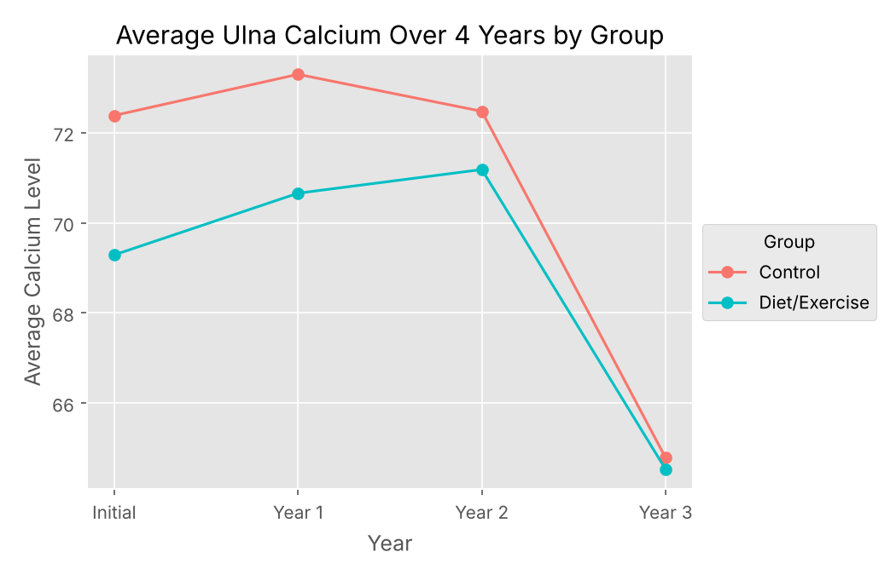
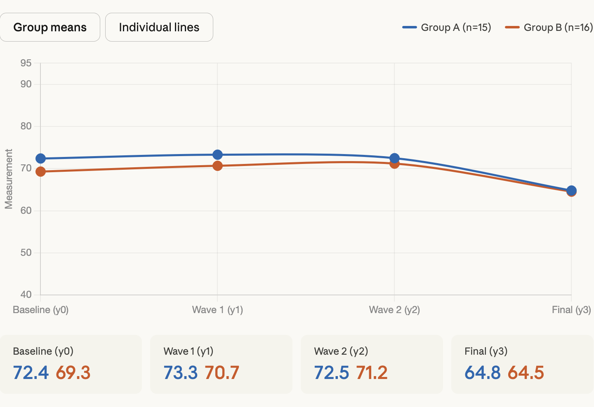
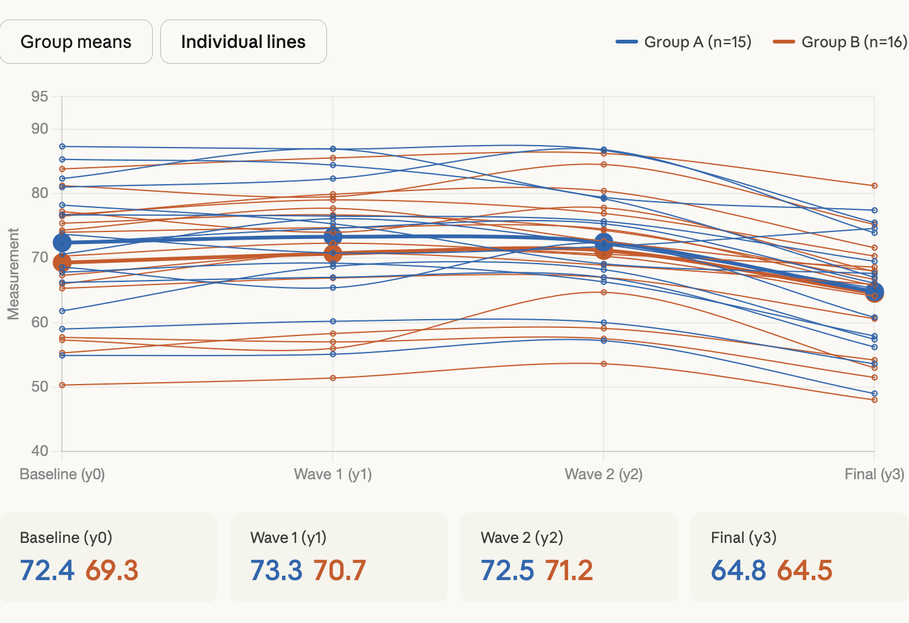

```{r}
#| label: setup
library(tidyverse)
library(knitr)
library(kableExtra)

# Diamonds Data
# Remove any rows with a 0 in any dimension, keep only the clarity and dimension columns
newDiamonds <- diamonds |>
  filter_out(x == 0 | y == 0 | z == 0) |>
  drop_na() |>
  select(clarity, x, y, z)

# Stack x, y, z into one column
cleanDiamonds <- newDiamonds |>
  pivot_longer(cols = c(x, y, z), names_to = "Variable", values_to = "value")

# Summaries for every clarity and all its variables 
claritySummary <- cleanDiamonds |>
  group_by(Variable, clarity) |>
  summarize(
    Count = length(value),
    Min = min(value),
    Q20 = quantile(value, 0.2),
    Q40 = quantile(value, 0.4),
    Median = median(value),
    Q60 = quantile(value, 0.6),
    Q80 = quantile(value, 0.8),
    Max = max(value),
    Mean = mean(value),
    SD = sd(value),
    .groups = "drop"   # drop the groupings 
  )

# All of the column names for the tables 
tableNames <- c("Clarity", "Freq.", "Min", "20%-tile", "40%-tile", "Median",
                "60%-tile", "80%-tile", "Max", "SAM", "SASD")

#Big 10 Data
# Load the BTAA women's basketball data
teams <- read_csv("teams.csv")
teambox <- read_csv("team_box.csv")

# Keep only the Big 10 teams
bigten_team <- teams |>
  filter(team == "Illinois" | team == "Indiana" | team == "Iowa" |
           team == "Maryland" | team == "Michigan" | team == "Michigan State" |
           team == "Minnesota" | team == "Nebraska" | team == "Northwestern" |
           team == "Ohio State" | team == "Penn State" | team == "Purdue" |
           team == "Rutgers" | team == "Wisconsin" | team == "UCLA" |
           team == "USC" | team == "Oregon" | team == "Washington") |>
  select(team_id, team, display_name, abbreviation, color, alternate_color)

# Keep only the Big 10 team games
bigten_data <- teambox |>
  inner_join(bigten_team, by = "team_id")

# Monte Carlo Data 
#@param x_min (num) the lowest bound for the x-coordinates
#@param x_max (num) the highest bound for the x-coordinates
#@param y_min (num) the lowest bound for the y-coordinates
#@param y_max (num) the highest bound for the y-coordinates
#@param n (int) the number of points that will be randomly placed
#@returns a data frame with n rows and two columns, x and y
#@details every point inside the rectangle has an equal chance of being picked
monte_points <- function(x_min, x_max, y_min, y_max, n){
  x_values <- runif(n = n, min = x_min, max = x_max) # random x-values within bounds
  y_values <- runif(n = n, min = y_min, max = y_max) # random y-values within bounds
  data_points <- data.frame(x = x_values, y = y_values) # pair them into a data frame
  return(data_points)
}

set.seed(184) # same random points every time the document renders

# Generate 10,000 points inside the rectangle
monte_data <- monte_points(x_min = 0, x_max = 4, y_min = 0, y_max = 0.8, n = 10000)

# Flag points on/below the Weibull curve and number each point
monte_flagged <- monte_data |>
  mutate(
    y_curve = dweibull(x, shape = 1.5, scale = 1),
    flag = if_else(y <= y_curve, "below/on", "above"),
    case = row_number()
  )

# Make one set of points for each resolution
monte_res <- bind_rows(
  monte_flagged |> filter(case <= 10) |> mutate(resolution = 10),
  monte_flagged |> filter(case <= 100) |> mutate(resolution = 100),
  monte_flagged |> filter(case <= 1000) |> mutate(resolution = 1000),
  monte_flagged |> mutate(resolution = 10000)
)

# Estimate the integral 
monte_estimates <- monte_res |>
  group_by(resolution) |>
  summarize(
    total_below = sum(flag == "below/on"),
    estimate = (total_below / n()) * (4 - 0) * (0.8 - 0)
  )

# Add each estimate
monte_res <- monte_res |>
  left_join(monte_estimates, by = "resolution") |>
  mutate(panel = paste("n =", resolution, "| Est. =", round(estimate, 4)))
```

# Diamonds Tables

In this section, I took the diamonds data, and organized it by length, width, and depth based on clarity level. These ranged from the best, IF, to the worst, I1. The diamond's clarity measures how many flaws or inclusions the diamond has. Each of the dimensions are measured in millimeters, and the diamonds that had a 0 for any of the dimensions were removed, since it isn't possible for a dimension to be 0.

```{r}
#| label: tbl-length
#| tbl-cap: "Summary of Diamond Lengths by Clarity"
#| tbl-pos: H
#| html-table-processing: none
# Make Diamond Length Table ----
claritySummary |>
  filter(Variable == "x") |>
  select(-Variable) |>
  kable(
    digits = 2,
    col.names = tableNames,
    format.args = list(big.mark = ","),
    align = "lcccccccccc"
  ) |>
  kable_classic(font_size = 10) |>
  add_footnote(
    label = c("Length was measured in millimeters."),
    notation = "none",
    threeparttable = TRUE
  )
```

@tbl-length shows the summaries of each of the clarities by lengths. There are 8 different clarity levels, and the lower levels seem to be the biggest and longest diamonds. This makes sense since the bigger it is, the higher the chance it has of having a flaw inside. You can see this by the median values dropping as you go down the table from worst to best. The medians drop from 6.64 mm at the top, to 4.57 mm at the bottom of the table. Since the smaller diamonds have no blemishes, it makes up for their size when looking at price.

```{r}
#| label: tbl-width
#| tbl-cap: "Summary of Diamond Widths by Clarity"
#| tbl-pos: H
#| html-table-processing: none
# Make Diamond Width Table ----
claritySummary |>
  filter(Variable == "y") |>
  select(-Variable) |>
  kable(
    digits = 2,
    col.names = tableNames,
    format.args = list(big.mark = ","),
    align = "lcccccccccc"
  ) |>
  kable_classic(font_size = 10) |>
  add_footnote(
    label = c("Width was measured in millimeters."),
    notation = "none",
    threeparttable = TRUE
  )
```

@tbl-width shows something similar to what the lengths showed. The lower the clarity level is, the higher the median widths are, 6.61 mm. The higher clarity levels which are lower on the table, are only 4.59 mm wide. Each of the widths here, are practically the same for each level as seen in @tbl-length. This could be because of how the diamonds are cut and sold. There are also fewer of the I1 clarity diamonds sold, which is probably because it's not as common to sell these diamonds if they have a lot of flaws.

```{r}
#| label: tbl-depth
#| tbl-cap: "Summary of Diamond Depths by Clarity"
#| tbl-pos: H
#| html-table-processing: none
# Make Diamond Depth Table ----
claritySummary |>
  filter(Variable == "z") |>
  select(-Variable) |>
  kable(
    digits = 2,
    col.names = tableNames,
    format.args = list(big.mark = ","),
    align = "lcccccccccc"
  ) |>
  kable_classic(font_size = 10) |>
  add_footnote(
    label = c("Depth was measured in millimeters."),
    notation = "none",
    threeparttable = TRUE
  )
```

@tbl-depth shows the same pattern: the more flawed diamonds are bigger, and they drop in median depth as you get better in clarity. The depths however are not as big as the lengths and widths, with the I1 median being 4.11 mm, while the IF is 2.80 mm. This shows that the diamonds are usually longer and wider than they are deep, and this goes for any clarity level. Looking at all of the tables together, it shows that the clarity and the size are related, where the bigger the diamond is, the more flaws it has.

# Big Ten Academic Alliance

In this section, the data is from the NCAA women's basketball Big Ten Academic Alliance (BTAA) Love Data Week competition. I used this and kept only the data for the 18 different Big Ten teams. I found the different averages for points scored in each game. I did this because I wanted to compare the teams, and looking at how good their offense is based on the amount of points they score on average is a good way of doing it.

```{r}
#| label: fig-btaa
#| fig-cap: "Average Points per Game for Big Ten Women's Basketball Teams"
#| fig-pos: H
#| fig-height: 4
#| fig-alt: "Bar chart showing the average points per game for the Big Ten women's basketball teams, organized from highest to lowest, horizontally."
# Make Bar Plot ----
bigten_data |>
  group_by(team) |>
  summarize(avg_points = mean(team_score)) |>
  ggplot(
    aes(
      x = avg_points,
      y = reorder(team, avg_points)  # sort bars from highest to lowest
    )
  ) +
  geom_col(fill = "#041E42") +
  labs(
    x = "Average Points per Game",
    y = "Team"
  ) +
  theme_bw() +
  theme(
    text = element_text(size = 12)
  )
```

@fig-btaa shows the average points scored per game for each Big Ten women’s basketball team. The graph is organized from most average points on the top, to lowest which is on the bottom. The highest two teams, Maryland and Iowa, average around 80 points per game. While on the bottom, Wisconsin and Rutgers only average around 63 points per game. This gives about a 17-point difference between the top and bottom teams. Penn state is right around the middle of the data, coming in around 8/18, averaging just above 70 points per game. This only shows the offensive scoring, the best team may not always be at the top average point wise, of they have a very strong defense.

# Monte Carlo Numerical Integration

In this section, I used the Monte Carlo method of estimating the area under a curve. The curve is a Weibull curve, using a scale of 1 and a shape of 1.5. I put randomly plotted points on a graph within the range from x=0 to x=4, and from y=0 to y=0.8. The plots were looked at as either being on/below the curve, or above the curve, and they were color-coded based on this. I was able to take the proportion of the points below/on the curve, and multiply it by the area of 3.2 (L\*W), to find an estimate of the area under the curve.

```{r}
#| label: fig-monteCarlo
#| fig-cap: "Monte Carlo Integration of the Weibull Curve"
#| fig-pos: H
#| fig-height: 5
#| fig-alt: !expr get_alt_text(get_last_plot())
# Make Monte Carlo Small Multiples ----
ggplot(
  data = monte_res,
  mapping = aes(x = x, y = y, color = flag)
) +
  geom_point(alpha = 0.5, size = 0.8) +
  stat_function(
    fun = dweibull,
    args = list(shape = 1.5, scale = 1),
    xlim = c(0, 4),
    color = "black"
  ) +
  facet_wrap(~ panel) + # puts in estimates
  scale_color_manual(values = c("above" = "#1E407C", "below/on" = "#BC204B")) +
  labs(
    x = "x",
    y = "y",
    color = "Point Location",
    alt = "Four scatter plots of random points above and below a Weibull curve at resolutions of 10, 100, 1,000, and 10,000 points."
  ) +
  theme_bw()
```

@fig-monteCarlo shows 4 different numbers of random points generated. The red points are the ones on the curve and below, while the blue ones are the ones above the curve. The data can't be trusted as much when using a lower amount of points plotted, even though it can be close at times, this only happens because of luck. More points are needed, because the shape isn't able to be seen. The more points you test, the better chance you have of making out what the curve looks like. The more random points you test, usually the more accurate of an estimation you'll get. For example the graph with 10 points is actually the closest one to the graph with 10,000. I would predict that the actual area is equal to a little less than 1, since that's where the estimation at 10,000 points seems to be going. The estimation for that was 0.9856, while at 10 points it was 0.96, at 100 points it was 0.928, and at 1,000 points it was 0.9504. This would make sense because it is a density function, and the area under it is always 1. But since our graphs only go from 0-4, it won't hold the entire area under the curve. The graphs placed side-by-side is for people to easily compare the visualizations and estimations.

# Planning and Prompting GenAI Tools

## My Plan 

**Goals:**

Tidy and graph the calcium data, to compare the different calcium levels of the ulna in women during a 4 year span, between the dieting/exercise group, and the null(nothing) group. 

**Sub Goals:**

- load data without changing 
- separate the groups, adjust column names, and delete any blank rows
- add labels and clean up the data 
- create a line plot, of calcium over the years for each different group 
- interpret a conclusion for this visualization 

**Needs:** 

- the calcium.csv file 
- packages(readr, dplyr, tidyr, ggplot2)
- both women's data is put together into one table, that is unlabeled, so each of the two test groups need their own table.
- they can be put together with a "group" column, either being no test or diet/exercising, and then give all the yearly measurements. 
- each row will be a woman with her measurement for that year, 4 rows per woman. - all 4 of the columns' names appear more than once. 
- each of the rows also isn't a singular case, in the original data set, each row contains information for 2. 
- there is also a blank half row at the bottom of the table, which is because the one group has more people than the other.
- there isn't a clear distinction yet of each woman and her personal measurement, there are no labels. 

**Steps:** 

1. load in the calcium.csv file completely unchanged
2. look at the first 4 columns as the null group that is the control group, and the next 4 columns as the group that's working on dieting and exercising. 
3. rename the different columns for each table y0-y3. 
4. add a column for the group the woman was in, and then an id for each(W1,W2)
5. stack both of the groups together
6. use pivot longer to make each row be a singular measurement for a singular woman for the year (4 rows per woman)
7. Have the columns be id, group, year, calcium amount 
8. Change the values for the year column to be Initial, Year 1, Year 2, and Year 3
9. Drop any extra rows that have any empty cells 
10. Check to make sure there are 124 rows (31 different women * 4 readings)(60 for the null group, 64 for the testing group)
12. Group the data by group and year, and calculate the average calcium for each group at each year(make sure there are 8 rows)
11. Create a line plot, showing year on the x-axis, calcium on the y-axis, color coded for the group and labeled (2 lines shown, showing averages)

## Plan-Informed Response 

The following response came from Anthropic’s Claude Opus 5.5 on November 18, 2026, after I gave it my plan and the unaltered calcium.csv file. Its plot is shown in @fig-planResponse. It was written in python, since Claude didn't have R installed. 

The code (calcium_analysis.R)

```r
library(readr)
library(dplyr)
library(tidyr)
library(ggplot2)

# Step 1: load unchanged (header repeats y0-y3, so skip it and use X1-X8)
calcium_raw <- read_csv("calcium.csv", col_names = FALSE, skip = 1)

# Steps 2-3: split into groups, rename y0-y3
control <- calcium_raw %>%
  select(1:4) %>%
  rename(y0 = X1, y1 = X2, y2 = X3, y3 = X4)

treatment <- calcium_raw %>%
  select(5:8) %>%
  rename(y0 = X5, y1 = X6, y2 = X7, y3 = X8)

# Step 4: group column + id
control <- control %>%
  mutate(group = "Control", id = paste0("W", row_number()))

treatment <- treatment %>%
  mutate(group = "Diet/Exercise", id = paste0("W", row_number() + nrow(control)))

# Step 5: stack
calcium_wide <- bind_rows(control, treatment)

# Steps 6-9: pivot longer, reorder columns, relabel years, drop blanks
calcium_tidy <- calcium_wide %>%
  pivot_longer(cols = y0:y3, names_to = "year", values_to = "calcium") %>%
  select(id, group, year, calcium) %>%
  mutate(year = recode(year,
                       "y0" = "Initial", "y1" = "Year 1",
                       "y2" = "Year 2",  "y3" = "Year 3")) %>%
  drop_na()

# Step 10: check counts
nrow(calcium_tidy)              # 124
calcium_tidy %>% count(group)   # Control 60, Diet/Exercise 64

# Step 12: averages (8 rows)
calcium_avg <- calcium_tidy %>%
  group_by(group, year) %>%
  summarize(avg_calcium = mean(calcium), .groups = "drop")

# Step 11: line plot
ggplot(calcium_avg, aes(x = year, y = avg_calcium, color = group, group = group)) +
  geom_line() +
  geom_point() +
  labs(title = "Average Ulna Calcium Over 4 Years by Group",
       x = "Year", y = "Average Calcium Level", color = "Group")
```

**Checks:**

- 124 rows in total: 60 Control and 64 Diet/Exercise
- 8 rows of averages:

| Year    | Control | Diet/Exercise |
|---------|---------|---------------|
| Initial | 72.38   | 69.29         |
| Year 1  | 73.29   | 70.66         |
| Year 2  | 72.47   | 71.18         |
| Year 3  | 64.79   | 64.53         |

**Conclusion:**

- The Control group started higher (about 72.4 vs 69.3).
- The Diet/Exercise group went up steadily through Year 2 (+1.9). The Control group went up a little in Year 1 and then came back down.
- Both groups dropped sharply in Year 3, by about 7–8 points, and ended almost tied (64.8 vs 64.5).
- Takeaway: diet and exercise seemed to slow calcium loss for the first two years. By Year 3 the two groups were basically the same, so these averages don't show a lasting benefit. This is only a visual comparison of averages, with no statistical test.

{#fig-planResponse fig-alt="Ulnar calcium line plot average for the control and diet/exercise groups over a four year span."}

## Generic Response 

The following prompt was given to Anthropic's Claude and was given in this assignment: "Prompt: Create a data visualization that will help me understand these data. Calclium.csv" The response has been reformatted for display in this document; its wording and values are unchanged. Its plots are shown in @fig-generic1 and @fig-generic2.

{#fig-generic1}

{#fig-generic2}

Here's what stands out in the data:

**Both groups follow the same pattern** — values stay relatively stable across the first three waves (y0→y1→y2), then drop noticeably at the final measurement (y3). This sharp decline at y3 is the dominant signal.

**Group A starts slightly higher** (baseline mean ~72.4 vs. ~69.3 for Group B), but both groups converge to nearly identical final values (~64.8 and ~64.5). That convergence is interesting — Group A drops about 7.5 points while Group B drops about 4.8.

## Comparison

In the plan made plot, there is only 2 lines shown (one for each of the averages at each year), because that's what my plan gave as the directions. The generic response however produced two graphs, one looked very similar to mine actually @fig-generic1, having just 2 color-coded lines, one for each of the averages for the groups. The second graph that the generic response came up with, has all 31 women shown, each with their own line, color-coded based on which group they fell into. The x-axes are also different in the graphs, mine label them initial and year1-3. The generic graphs made them Baseline, Wave 1, Wave 2, and final. The plot generated is able to be read nicely, but it does not show all of the individual women like shown in @fig-generic2.

In my plan, I said what each of the different groups were, so this was able to be labeled in the graph. The generic response only gave Group A and Group B, this makes it hard for the audience to differentiate. It doesn't specify which group was which. They start at 72.4 and 69.3 for each, which is just exactly what mine started as too. When the plan was given, Claude was able to see what was being tested which helped make the graph. Finally, my plan also was able to give checks for each of the tidying steps, making sure it was done correctly. The generic response just says that the lines converge, but with the plan, we can see that the diet/exercising seemed to slow down the calcium loss for 2 years. 

This activity showed that the generative AI model is able to make accurate plots and graphs using data, but it doesn't have the ability to interpret the context unless asked. The generic response used purely the numbers, and didn't use comparisons to make conclusions. It made it a lot easier to write the plan first, since I was then able to check to make sure it was correct. The generic response however, did show an informative graph where each individual woman was given their own line. This shows that you need to be specific when giving a plan to AI, because it'll follow it literally. Clear instructions, and an user understanding of the data is crucial. 

# Reflection

Looking back so far on this course, I was able to learn how to make my work reproducible. Before this class even, I would have to use graphings apps, or even my calculator in order to make graphs. Now, I am able to put all of my code and tables into a singular Quarto doc, that can rebuild itself every time someone renders it. I know that all the data must be organized and tidied in order to be used well, like what I did in the Diamond HW #3.1 and #3.2. I was also able to use cross referencing between them, which linked things like @tbl-depth. Also like the calcium data, this was messy when it was originally downloaded, so I needed to use known functions to make it better(like pivot_longer and drop_na).

I was also able to learn, based on my scores in the Monte Carlo assignment, that using runif() allows me to make better points. The way I did it, points could only be placed every 0.1 points on the grid. This made it all not as random as it could've been. Some things I need to work on is making sure to create a plan always before jumping into anything, and checking over my work to make sure it runs and there are no errors. Like for this, even with the plan, Claude used python to create the code because it didn't have R installed. These things have to be looked at and checked by people every time. 

I was finally able to look at these gen AI tools in a different sense, I can see that Claude can do the math and make the graphs right away, but it doesn't have the critical thinking ability that we humans have. Like for this, it just labeled them group A and group B. AI can be used to speed up the tedious tasks, but it cannot interpret things as well as people, and it still does always make mistakes that need to be checked. Claude can also use it's own type of plan, like when it used python to make the coding because it didn't have R installed. 



# GenAI Usage Appendix

## Usage

- **Tool:** Anthropic's Claude Opus 5.5 
- **Date:** November 18, 2026 
- **Prompt:** 
```
Using the attached calcium.csv, please carry out the following plan in R using the tidyverse. Show the code and the resulting plot. 

**Goals:**

Tidy and graph the calcium data, to compare the different calcium levels of the ulna in women during a 4 year span, between the dieting/exercise group, and the null(nothing) group. 

**Sub Goals:**

load data without changing
separate the groups, adjust column names, and delete any blank rows
add labels and clean up the data
create a line plot, of calcium over the years for each different group
interpret a conclusion for this visualization

**Needs:** 

the calcium.csv file
packages(readr, dplyr, tidyr, ggplot2)
both women's data is put together into one table, that is unlabeled, so each of the two test groups need their own table.
they can be put together with a "group" column, either being no test or diet/exercising, and then give all the yearly measurements.
each row will be a woman with her measurement for that year, 4 rows per woman. - all 4 of the columns' names appear more than once.
each of the rows also isn't a singular case, in the original data set, each row contains information for 2.
there is also a blank half row at the bottom of the table, which is because the one group has more people than the other.
there isn't a clear distinction yet of each woman and her personal measurement, there are no labels.

**Steps:** 

load in the calcium.csv file completely unchanged
look at the first 4 columns as the null group that is the control group, and the next 4 columns as the group that's working on dieting and exercising.
rename the different columns for each table y0-y3.
add a column for the group the woman was in, and then an id for each(W1,W2)
stack both of the groups together
use pivot longer to make each row be a singular measurement for a singular woman for the year (4 rows per woman)
Have the columns be id, group, year, calcium amount
Change the values for the year column to be Initial, Year 1, Year 2, and Year 3
Drop any extra rows that have any empty cells
Check to make sure there are 124 rows (31 different women * 4 readings)(60 for the null group, 64 for the testing group)
Group the data by group and year, and calculate the average calcium for each group at each year(make sure there are 8 rows)
Create a line plot, showing year on the x-axis, calcium on the y-axis, color coded for the group and labeled (2 lines shown, showing averages)
```

- **Response:** 
```
Heads up: R isn’t installed in my workspace, so I couldn’t run the R code myself. I ran the exact same steps in Python to check the numbers and draw the plot. The counts and averages will match what you get in R, but your plot will look like standard ggplot2.

The code (calcium_analysis.R)
r
library(readr)
library(dplyr)
library(tidyr)
library(ggplot2)

# Step 1: load unchanged (header repeats y0-y3, so skip it and use X1-X8)
calcium_raw <- read_csv("calcium.csv", col_names = FALSE, skip = 1)

# Steps 2-3: split into groups, rename y0-y3
control <- calcium_raw %>%
  select(1:4) %>%
  rename(y0 = X1, y1 = X2, y2 = X3, y3 = X4)

treatment <- calcium_raw %>%
  select(5:8) %>%
  rename(y0 = X5, y1 = X6, y2 = X7, y3 = X8)

# Step 4: group column + id
control <- control %>%
  mutate(group = "Control", id = paste0("W", row_number()))

treatment <- treatment %>%
  mutate(group = "Diet/Exercise", id = paste0("W", row_number() + nrow(control)))

# Step 5: stack
calcium_wide <- bind_rows(control, treatment)

# Steps 6-9: pivot longer, reorder columns, relabel years, drop blanks
calcium_tidy <- calcium_wide %>%
  pivot_longer(cols = y0:y3, names_to = "year", values_to = "calcium") %>%
  select(id, group, year, calcium) %>%
  mutate(year = recode(year,
                       "y0" = "Initial", "y1" = "Year 1",
                       "y2" = "Year 2",  "y3" = "Year 3")) %>%
  drop_na()

# Step 10: check counts
nrow(calcium_tidy)              # 124
calcium_tidy %>% count(group)   # Control 60, Diet/Exercise 64

# Step 12: averages (8 rows)
calcium_avg <- calcium_tidy %>%
  group_by(group, year) %>%
  summarize(avg_calcium = mean(calcium), .groups = "drop")

# Step 11: line plot
ggplot(calcium_avg, aes(x = year, y = avg_calcium, color = group, group = group)) +
  geom_line() +
  geom_point() +
  labs(title = "Average Ulna Calcium Over 4 Years by Group",
       x = "Year", y = "Average Calcium Level", color = "Group")
Checks
124 rows in total: 60 Control and 64 Diet/Exercise 
8 rows of averages:
Year	Control	Diet/Exercise
Initial	72.38	69.29
Year 1	73.29	70.66
Year 2	72.47	71.18
Year 3	64.79	64.53
Conclusion
The Control group started higher (about 72.4 vs 69.3).
The Diet/Exercise group went up steadily through Year 2 (+1.9). The Control group went up a little in Year 1 and then came back down.
Both groups dropped sharply in Year 3, by about 7–8 points, and ended almost tied (64.8 vs 64.5).
Takeaway: diet and exercise seemed to slow calcium loss for the first two years. By Year 3 the two groups were basically the same, so these averages don’t show a lasting benefit. This is only a visual comparison of averages, with no statistical test.
```



# Code Appendix

```{r}
#| label: codeAppendix
#| ref.label: !expr knitr::all_labels()
#| echo: true
#| eval: false
```
